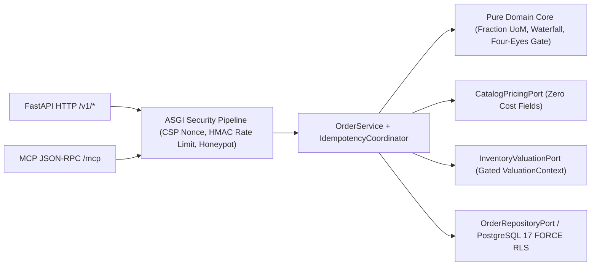

# LedgerGuard

[](https://github.com/mfelisberto90/ledger-guard/actions/workflows/ci.yml)
[](https://www.python.org/downloads/)
[](./LICENSE)
[](https://m8ven.ai/mcp/mfelisberto90-ledger-guard-b5gzoa?s=readme)

Binary floats silently wreck commercial ledgers. If you round a 3-bottle case split (`1/3` unit ratio) too early, you'll leak a penny on every single order, and if your AI tool endpoints return raw ORM rows, you'll hand confidential supplier costs to staff who shouldn't see them.

I've built **LedgerGuard** as my clean-room Python 3.12 reference architecture for B2B ERP pricing, margin governance, and multi-tenant API security. You don't touch binary floats anywhere in our domain core. Every quantity, unit-of-measure ratio, and discount allocation stays in exact `fractions.Fraction` maths until we settle into integer minor units (`pence`, `cents`, `yen`) via Euclidean `ROUND_HALF_EVEN`. Because our FastAPI HTTP routes and Model Context Protocol (`POST /mcp`) JSON-RPC server call the exact same `OrderService`, your web clients and your AI agents obey identical RBAC, idempotency, and tenant boundaries.

## Why I Built It This Way

Most pricing demos bolt margin checks onto the frontend. That doesn't survive contact with real B2B sales teams.

Say your sales rep adds £500.00 of pass-through carrier freight onto a loss-making valve order. If your engine mixes freight into product revenue, it'll mask a sub-floor discount and wave the order straight past your 20.00% (`2000 bps`) floor. Or suppose your warehouse team revalues stock on Tuesday afternoon: orders you've already confirmed on Monday morning shouldn't suddenly break because a query read a mutable cost table instead of an immutable `CostSnapshot`. We've locked down both invariants in pure Python 3.12 domain code with zero I/O imports.



## What You Get Out of the Box

- **Six-step condition waterfall**: We run `BASE_PRICE`, `QUANTITY_DISCOUNT`, penny-exact `HEADER_DISCOUNT_SPREAD`, `PASSTHROUGH_FREIGHT`, `SMALL_ORDER_SURCHARGE`, and `STATISTICAL_VALUATION_COST` in strict order. You'll bill freight and surcharges in `payable_total_minor`, yet they're never counted inside `net_goods_total_minor` or your gross margin basis.
- **Four-eyes separation of duties (`orders:margin:approve`)**: When your tenant policy is set to `block`, sub-floor orders land in `pending_approval`. You can't approve an order you've created or last amended yourself, even if you vary letter casing on your `principal_id`, and every approval records a mandatory reason in an append-only `ApprovalRecord`. If someone later lowers the unit price or raises a discount on a confirmed order, we increment `pricing_version` and drop your order right back into `pending_approval`.
- **Capability-based view projection (`project_order_for_principal`)**: When your warehouse staff or standard sales reps lack `valuation:cost:read` and `orders:margin:read`, we strip `unit_cost_minor`, `total_cost_minor`, `margin_minor`, `margin_bps`, and statistical cost steps before serialising HTTP JSON, MCP payloads, or CSV exports. They'll still see `{gate, met, code, remediation}` so they know what's blocking confirmation without ever seeing your supplier buy prices.
- **PostgreSQL 17 `FORCE ROW LEVEL SECURITY`**: In `sql/001_init_force_rls.sql`, we split `app_migrator` from `app_runtime` (`NOBYPASSRLS`) and enforce `ENABLE` + `FORCE ROW LEVEL SECURITY` on all 6 tables with `NULLIF(current_setting('app.current_tenant_id', true), '')::uuid`. Our `PostgresTenantSession` binds transaction-local context in two stages and checks `transaction_depth == 0` when your request finishes so pooled connections can't bleed state across tenants.
- **OWASP ASVS Level 2 & Mozilla Observatory `A+` defences**: You get a fresh 18-byte base64 CSP `nonce` on every request, `HSTS preload`, `COOP`/`CORP`, `BoundedMap` `HMAC-SHA256` rate limiting (`principal` 5/min with `60s -> 300s -> 900s -> 3600s -> 86400s` lockouts while keeping your `ip` 60/min password-spraying bucket intact after login), `SHA-256` payload-bound idempotency (`409` on mismatch), raw-bytes webhook verification (`<= 300s` + atomic `event_id` claim), CGNAT-safe honeypots, Unicode full-width CSV formula guards, and Luhn PAN log redaction.

## Repository Layout

```text
src/ledger_guard/
  domain/        Pure Python 3.12 pricing, Fraction UoM, margin gate & RBAC projection
  ports/         Protocol interfaces isolating catalog pricing from valuation & storage
  adapters/      Fail-closed in-memory store + PostgreSQL 17 2-stage FORCE RLS session
  security/      scrypt auth, HMAC rate limiter, idempotency, webhooks, redactor, ASGI headers
  application/   Shared OrderService orchestrating HTTP and MCP mutations
  api/           FastAPI routes (/v1/orders, /v1/auth/login, /v1/webhooks/{provider}, /robots.txt)
  mcp/           Model Context Protocol JSON-RPC 2.0 server (initialize, tools/list, tools/call)
sql/             001_init_force_rls.sql PostgreSQL 17 DDL (app_migrator vs app_runtime)
scripts/         security-lint.py enforcing 8 architectural & financial invariants in CI
tests/           65 positive, boundary, concurrency, IDOR, BFLA, and MCP parity tests
```

## Quickstart

Install Python 3.12+ and [`uv`](https://docs.astral.sh/uv/), sync our locked environment, and run all four CI gates on your machine:

```bash
uv sync --frozen --dev

uv run ruff check src tests scripts
uv run mypy --strict src
uv run python3 scripts/security-lint.py
uv run pytest -v
```

If you'd like to boot the FastAPI + MCP server locally with Uvicorn:

```bash
uv run uvicorn ledger_guard.api.app:create_app --factory --host 127.0.0.1 --port 8000
```

## Dual Transport Parity (REST & MCP)

Whether your order arrives via `POST /v1/orders` or an AI agent calling `POST /mcp` (`tools/call`), we resolve `tenant_id` strictly from your verified `Authorization: Bearer` token. If a caller or prompt-injected model tries smuggling `tenant_id` inside the JSON body or MCP arguments, we reject it immediately (`422` on HTTP and `CLIENT_TENANT_OVERRIDE_FORBIDDEN` on MCP) rather than trusting client input.

We expose five tools on `POST /mcp`: `create_order`, `get_order`, `confirm_order`, `approve_margin`, and `amend_order_line`.

## Security Policy & Licence

Read [SECURITY.md](./SECURITY.md) if you're auditing our threat model, data classification tiers, or vulnerability reporting process. Released under the [MIT Licence](./LICENSE) by Murilo Felisberto in Edinburgh, Scotland, UK.
